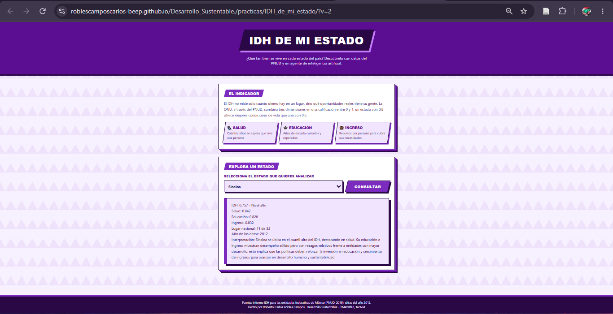
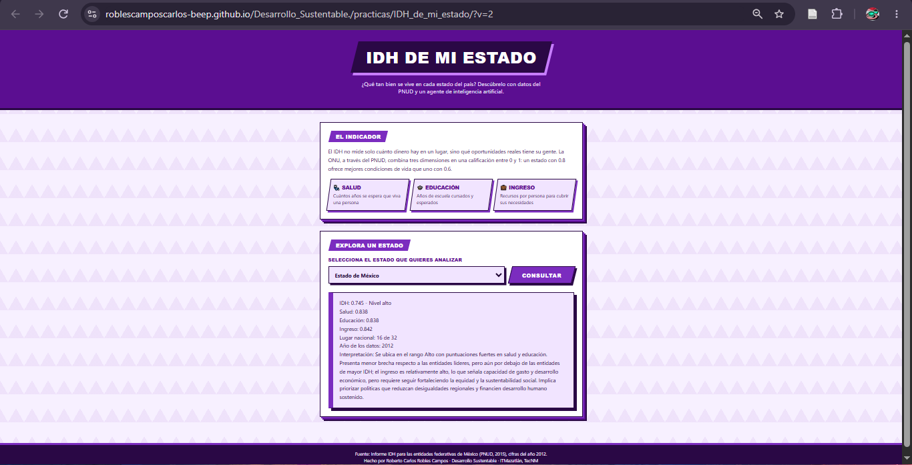
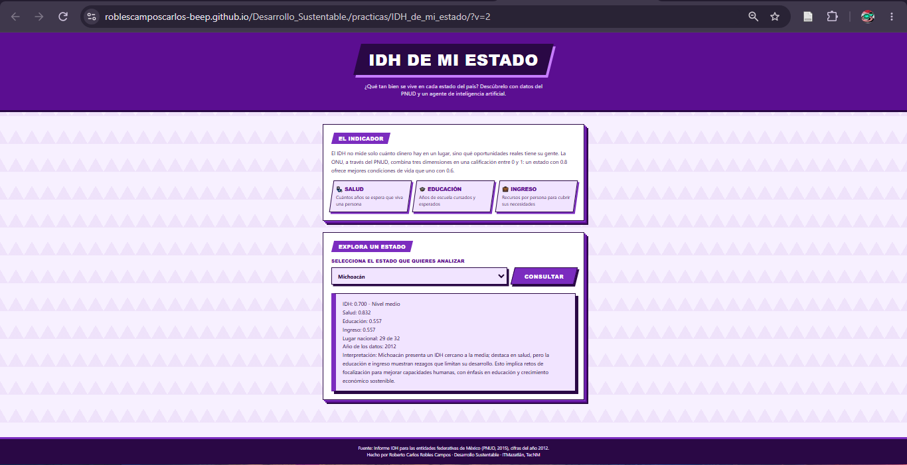
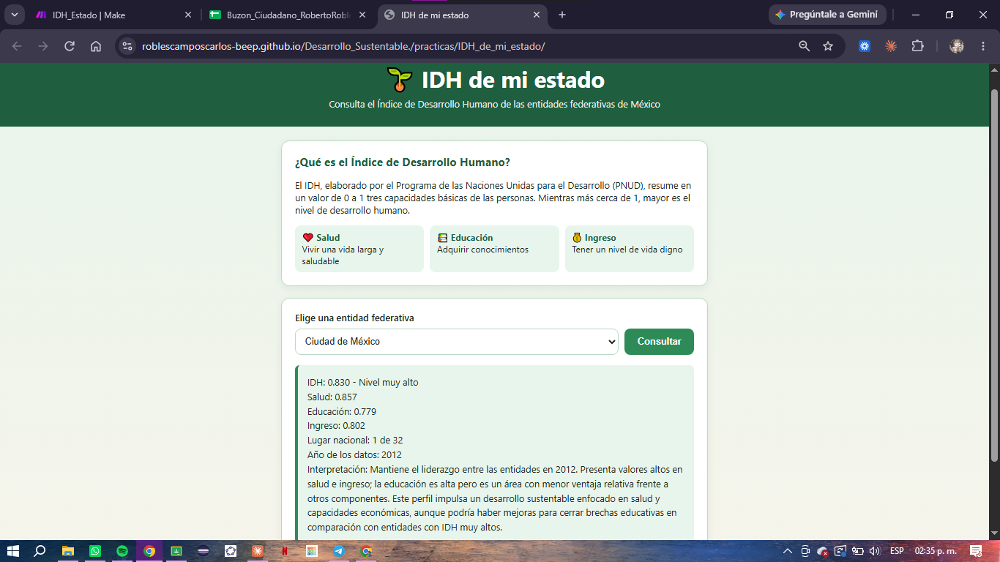
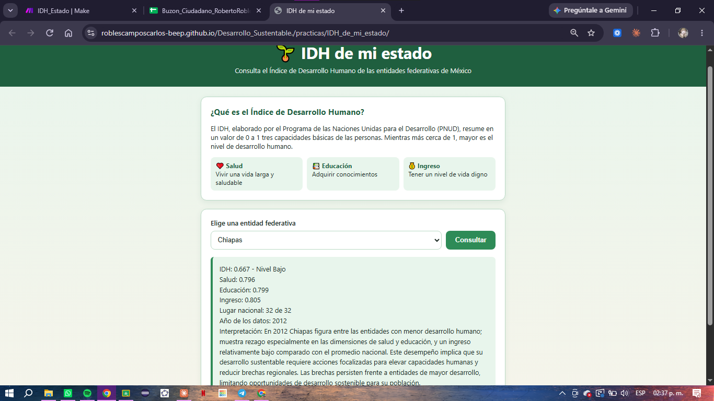

# Práctica 3.2 — Página web "IDH de mi estado"

**Materia:** Desarrollo Sustentable (ACD-0908) · **Unidad 3:** Escenario socio-cultural · **Tema:** 3.2 Cultura, diversidad socio-cultural
**Autor:** Roberto Carlos Robles Campos · **Institución:** Instituto Tecnológico de Mazatlán
**Herramientas:** IA generativa, Make (Webhooks, Make AI Agent, Webhook Response), GitHub Pages

- **Página publicada:** <https://roblescamposcarlos-beep.github.io/Desarrollo_Sustentable./practicas/IDH_de_mi_estado/>
- **Fuente de datos:** [`codigo/IDH_entidades.pdf`](codigo/IDH_entidades.pdf) (4 páginas del informe del PNUD, datos de 2012)
- **Código de la página:** [`codigo/index.html`](codigo/index.html)
- **Escenario de Make:** [`codigo/blueprint.json`](codigo/blueprint.json)
- **Resumen de lo aprendido (PDF):** [`resultados/Resultados.pdf`](resultados/Resultados.pdf)

## 1. Descripción y objetivo

Página web donde se elige una de las 32 entidades de México y un agente de IA
de Make responde con su Índice de Desarrollo Humano (IDH), sus tres
componentes, su lugar nacional y una interpretación, usando únicamente un
extracto del informe del PNUD.

El objetivo es interpretar el IDH y sus componentes, construir sin programar
una página conectada a Make e IA que consulte datos oficiales, y **verificar
que la información generada por la IA sea fiel a la fuente**.



## 2. Arquitectura


```
Página web (index.html)
     │  POST  entidad=Sinaloa
     ▼
Make: Webhooks → Custom webhook
     ▼
Make AI Agent (Knowledge: IDH_entidades.pdf)
     ▼
Webhooks → Webhook response (texto plano + CORS)
     │
     ▼
Página web: muestra la respuesta
```

| # | Módulo | Configuración |
|---|---|---|
| 1 | Webhooks → Custom webhook | Recibe el campo `entidad` que envía la página |
| 2 | Make AI Agent | Conexión *Make's AI Provider* · Knowledge = `IDH_entidades.pdf` · Input = `Entidad: {{1.entidad}}` · Instrucciones: analista de desarrollo humano, solo datos del archivo, texto plano, formato fijo |
| 3 | Webhooks → Webhook response | Status `200` · Body = respuesta del agente · Headers `Content-Type: text/plain; charset=utf-8` y `Access-Control-Allow-Origin: *` |

El escenario se ejecuta **Immediately** (cada vez que llega una consulta).

**Problemas que encontré y cómo los resolví:**
1. Las primeras consultas respondían *"No encontré datos de esa entidad en el documento."* El PDF se había subido pero no quedó guardado dentro del módulo Knowledge (la lista de archivos estaba vacía). Se volvió a agregar y se guardó el escenario.
2. Al guardar desde el editor se borraron las Instrucciones del agente y el Input quedó como `{{1.entidad}}`. Se restauraron las Instrucciones y el Input `Entidad: {{1.entidad}}`.

## 3. La página (`index.html`)

La página tiene un encabezado, una explicación breve del IDH con sus tres
componentes, una lista con las 32 entidades y un botón **Consultar**. El botón
envía la entidad al webhook con `fetch` (POST, cuerpo con `URLSearchParams` y un
solo campo `entidad`) y muestra la respuesta en texto plano. Mientras espera, el
botón se desactiva y dice *"Consultando..."*; si algo falla, muestra *"No se
pudo obtener la información, intenta de nuevo."*

## 4. Investigación de conceptos

**Desarrollo humano.** El PNUD lo define como el proceso de ampliar las
opciones y libertades de las personas para que puedan vivir la vida que
valoran. No se mide solo por el crecimiento económico, sino por lo que las
personas pueden ser y hacer: vivir sanas, aprender y tener recursos para una
vida digna.

**Índice de Desarrollo Humano y sus tres componentes.** Va de 0 a 1 y es la
media geométrica de tres índices:

| Componente | Qué representa | Cómo se mide |
|---|---|---|
| Salud (IS) | Vivir una vida larga y saludable | Esperanza de vida al nacer |
| Educación (IE) | Adquirir conocimientos | Años promedio de escolaridad y años esperados de escolarización |
| Ingreso (II) | Tener un nivel de vida digno | Ingreso Nacional Bruto per cápita en dólares PPC |

Según el informe, en 2012 las entidades se clasificaron en cuatro niveles: muy
alto (0.760–0.830), alto (0.745–0.760), medio (0.723–0.742) y bajo
(0.667–0.720).

**Índice de rezago social (CONEVAL) e índice de desarrollo social.** El
Índice de Rezago Social resume en un número varias carencias (rezago educativo,
acceso a salud, calidad de la vivienda, servicios básicos y activos del hogar) y
ordena entidades, municipios y localidades en cinco grados, de muy bajo a muy
alto. No mide pobreza porque no incluye el ingreso. El índice de desarrollo
social es la lectura "en positivo": un desarrollo social alto equivale a un
rezago bajo. A diferencia del IDH, el rezago social llega hasta la localidad.

**Desarrollo urbano y rural.** Lo urbano son las localidades de 2,500
habitantes o más (criterio del INEGI), con más servicios, empleo formal y
transporte, pero con problemas como crecimiento desordenado y contaminación. Lo
rural son las de menos de 2,500, con población dispersa, más actividades
primarias, escuelas y clínicas más lejanas e ingresos más bajos. Un promedio
estatal alto puede esconder comunidades rurales con rezago muy alto.

## 5. Archivo de conocimiento

Del informe *Índice de Desarrollo Humano para las Entidades Federativas, México
2015* (PNUD) se guardaron solo 4 páginas en `IDH_entidades.pdf`:

| Página | Contenido |
|---|---|
| 1 (informe p. 7) | Cuadro 1: categorías de desarrollo humano |
| 2 (informe p. 9) | Cuadro 2: IDH 2008, 2010 y 2012 y posición nacional de las 32 entidades |
| 3 (informe p. 10) | Cuadro 3, parte izquierda: Índice de Salud y parte del de Educación |
| 4 (informe p. 11) | Cuadro 3, parte derecha: Educación 2012 e Ingreso |

Se incluyó el Cuadro 1 porque el formato pide el nivel del IDH y ese dato no
viene en las tablas de valores. El archivo pesa 143 KB, así que cada consulta
gasta menos créditos que con el informe completo.

## 6. Pruebas y verificación: IA contra el PDF

Se consultaron desde la página publicada cinco entidades: Sinaloa, la de IDH más
alto (Ciudad de México, "Distrito Federal" en el informe), la de IDH más bajo
(Chiapas) y, además, Estado de México y Michoacán.

| Sinaloa | Estado de México | Michoacán |
|---|---|---|
|  |  |  |

| Ciudad de México (IDH más alto) | Chiapas (IDH más bajo) |
|---|---|
|  |  |

### Sinaloa
| Dato | Valor según la IA | Valor en el PDF | ¿Coincide? |
|---|---|---|---|
| IDH | 0.757 | 0.757 | ✅ Sí |
| Nivel | Alto | Alto (0.745–0.760) | ✅ Sí |
| Salud | 0.842 | 0.832 | ❌ No (0.842 es el IS de 2008) |
| Educación | 0.828 | 0.649 | ❌ No (0.828 es el IS de 2010) |
| Ingreso | 0.832 | 0.805 | ❌ No (0.832 es el IS de 2012) |
| Lugar nacional | 11 de 32 | 11 de 32 | ✅ Sí |
| Año | 2012 | 2012 | ✅ Sí |

### Ciudad de México (Distrito Federal en el informe)
| Dato | Valor según la IA | Valor en el PDF | ¿Coincide? |
|---|---|---|---|
| IDH | 0.830 | 0.830 | ✅ Sí |
| Nivel | Muy alto | Muy alto (0.760–0.830) | ✅ Sí |
| Salud | 0.857 | 0.857 | ✅ Sí |
| Educación | 0.779 | 0.783 | ❌ No (0.779 es el IE de 2010) |
| Ingreso | 0.802 | 0.852 | ❌ No (0.802 es el II de otra entidad) |
| Lugar nacional | 1 de 32 | 1 de 32 | ✅ Sí |
| Año | 2012 | 2012 | ✅ Sí |

### Chiapas
| Dato | Valor según la IA | Valor en el PDF | ¿Coincide? |
|---|---|---|---|
| IDH | 0.667 | 0.667 | ✅ Sí |
| Nivel | Bajo | Bajo (0.667–0.720) | ✅ Sí |
| Salud | 0.796 | 0.805 | ❌ No (0.796 es el IS de 2008) |
| Educación | 0.799 | 0.528 | ❌ No (0.799 es el IS de 2010) |
| Ingreso | 0.805 | 0.700 | ❌ No (0.805 es el IS de 2012) |
| Lugar nacional | 32 de 32 | 32 de 32 | ✅ Sí |
| Año | 2012 | 2012 | ✅ Sí |

### Estado de México
| Dato | Valor según la IA | Valor en el PDF | ¿Coincide? |
|---|---|---|---|
| IDH | 0.745 | 0.745 | ✅ Sí |
| Nivel | Alto | Alto (0.745–0.760) | ✅ Sí |
| Salud | 0.838 | 0.842 | ❌ No (0.838 es el IS de 2008 y 2010) |
| Educación | 0.838 | 0.619 | ❌ No (0.838 es el IS de 2010) |
| Ingreso | 0.842 | 0.793 | ❌ No (0.842 es el IS de 2012) |
| Lugar nacional | 16 de 32 | 16 de 32 | ✅ Sí |
| Año | 2012 | 2012 | ✅ Sí |

### Michoacán
| Dato | Valor según la IA | Valor en el PDF | ¿Coincide? |
|---|---|---|---|
| IDH | 0.700 | 0.700 | ✅ Sí |
| Nivel | Medio | Bajo (0.667–0.720) | ❌ No |
| Salud | 0.832 | 0.832 | ✅ Sí |
| Educación | 0.557 | 0.543 | ❌ No (0.557 es el IE de 2010) |
| Ingreso | 0.557 | 0.760 | ❌ No (0.557 es el IE de 2010) |
| Lugar nacional | 29 de 32 | 29 de 32 | ✅ Sí |
| Año | 2012 | 2012 | ✅ Sí |

**Resumen:** de 35 datos verificados (5 entidades × 7), **21 coinciden (60 %)** y
**14 no coinciden (40 %)**.

- El IDH, el año y el lugar nacional salieron bien casi siempre: vienen del Cuadro 2, una tabla sencilla donde cada renglón lleva el nombre de la entidad.
- Los **componentes fallaron en las cinco entidades**. En Sinaloa, Chiapas y Estado de México la IA tomó los tres valores del Índice de Salud (2008, 2010 y 2012) y los reportó como Salud, Educación e Ingreso. En Ciudad de México y Michoacán mezcló años y valores de otros renglones.
- La causa probable es que el Cuadro 3 ocupa dos páginas y en la segunda (Educación 2012 e Ingreso) **no aparecen los nombres de las entidades**, así que la IA no supo a qué renglón correspondía cada valor.
- Michoacán (0.700) cae en el rango "bajo" del Cuadro 1, pero la IA dijo "medio". Las instrucciones de la práctica solo mencionan muy alto, alto y medio, aunque el PDF sí incluye el nivel bajo.
- Las respuestas **no son constantes**: una consulta previa de Sinaloa ([captura](imagenes/prueba_previa_sinaloa.png)) respondió "lugar 7 de 32" (su lugar de 2008) y la consulta nueva respondió 11, que es el correcto.

### Créditos consumidos (historial del escenario)

| Consulta | Duración | Operaciones | Créditos |
|---|---|---|---|
| 1 | 17.5 s | 4 | 5.29 |
| 2 | 9.8 s | 4 | 4.87 |
| 3 | 18.4 s | 4 | 5.39 |
| **Promedio** | **15.2 s** | **4** | **≈ 5.2 créditos por consulta** |

Antes de cargar bien el archivo de conocimiento, las consultas gastaban entre
3.3 y 5.3 créditos y respondían "no encontré datos": gastar créditos no
garantiza una respuesta útil.

## 7. Video de la prueba en vivo

[Ver la prueba en YouTube](https://youtu.be/foaxm_FOj2k) — "Práctica IDH de
estado": la página publicada, el escenario en Make, una consulta en vivo y el
costo en créditos.

Enlace también en [`video/enlace.txt`](video/enlace.txt).

## 8. Preguntas de reflexión

**1. ¿En qué componente tiene Sinaloa su mayor fortaleza y su mayor rezago? ¿Coincide con lo que observas en tu comunidad?**
Según el PDF, la **mayor fortaleza** de Sinaloa es la **educación**: con un IE de 0.649 ocupa el **5.º lugar nacional**. El **mayor rezago** es la **salud**: con un IS de 0.832 está en el **lugar 24 de 32**. Entre 2008 y 2012 perdió 13 posiciones en salud, la caída más grande del país en esa dimensión. En ingreso está a media tabla (0.805, lugar 14) y bajó 5 lugares. Coincide con lo que se ve en Mazatlán: hay muchas escuelas, preparatorias y universidades como el Tec, pero la salud se ve afectada por la saturación de hospitales públicos, enfermedades crónicas y la violencia, que reduce la esperanza de vida, justo lo que mide el índice de salud. Ojo: la respuesta de la IA decía lo contrario ("destacando en salud"), porque había confundido los valores.

**2. ¿Qué explica la diferencia entre la entidad con mayor y menor IDH? ¿Es un tema de justicia y equidad?**
Ciudad de México (0.830) y Chiapas (0.667) están en los extremos. La brecha más grande está en **educación**: el IE de la capital (0.783) es 48.3 % mayor que el de Chiapas (0.528). En ingreso la diferencia es 0.852 contra 0.700. Lo explican la concentración histórica de inversión, servicios, empleos formales y universidades en la capital, frente a un estado con mucha población rural dispersa e indígena y menos infraestructura. **Sí es un tema de justicia y equidad**: nacer en Chiapas o en la Ciudad de México no debería decidir cuántos años vas a estudiar o cuánto vas a vivir. El desarrollo sustentable exige reducir esas brechas y no solo subir el promedio nacional.

**3. ¿Qué diferencias urbano-rurales de Sinaloa esconde el promedio estatal?**
El 0.757 de Sinaloa es un promedio. Mezcla ciudades como Culiacán, Mazatlán y Los Mochis, con hospitales, universidades y empleo formal, con **municipios serranos** como Badiraguato, Choix, Cosalá o San Ignacio, donde las clínicas y escuelas quedan lejos, hay menos servicios en la vivienda y el ingreso depende de actividades primarias. También esconde a los jornaleros agrícolas de los valles, con trabajos temporales y viviendas precarias, y a las comunidades pesqueras. Para ver esas diferencias se necesitan datos municipales o por localidad, como el Índice de Rezago Social del CONEVAL.

**4. ¿Qué riesgo hay en decidir con datos de 2012? ¿Por qué no hay datos más recientes por entidad?**
El riesgo es diseñar políticas para una realidad que ya cambió. Desde 2012 pasaron la pandemia de COVID-19 (que bajó la esperanza de vida) y cambios en programas sociales, empleo y seguridad. Una decisión con datos de hace más de 10 años puede mandar recursos a donde ya no hacen falta y olvidar a quien hoy está peor. No hay datos más recientes por entidad con esta misma metodología porque el IDH estatal depende de un informe especial del PNUD que necesita estimar el ingreso por entidad y combinar censos y encuestas, y ese informe no se publica cada año. Por eso siempre hay que revisar el **año** de los datos antes de usarlos.

**5. ¿La IA respetó los datos del PDF? ¿Qué aprendiste sobre verificar lo que responde?**
**Solo en parte.** Acertó el IDH y el año en las cinco entidades y casi siempre el lugar nacional, pero **falló los componentes en las cinco**: 14 de 35 datos estaban mal, aunque la instrucción decía *"No inventes cifras"*. Lo peligroso es que las respuestas **se ven correctas**: formato limpio, números con tres decimales e interpretaciones convincentes. Si no hubiera comparado con el PDF, habría creído que el índice de educación de Sinaloa es 0.828, cuando en realidad es 0.649. Aprendí que:
- La IA **no reemplaza la fuente**: hay que verificar cada cifra contra el documento original.
- El **formato del archivo importa**: una tabla partida en dos páginas, sin nombres en la segunda, confunde al modelo. Una tabla limpia, con una entidad por renglón, daría mejores resultados.
- Que la IA responda con seguridad no prueba que haya leído bien, y verificar un solo dato no basta: Michoacán acertó la salud y aun así falló la educación, el ingreso y el nivel.

## 9. Fuentes

- PNUD México (2015). *Índice de Desarrollo Humano para las Entidades Federativas, México 2015*. Cuadros 1, 2 y 3 (datos de 2012). https://www.undp.org/sites/g/files/zskgke326/files/migration/mx/PNUD_boletinIDH-final.pdf
- PNUD México (2023). *Informe de Desarrollo Humano Municipal 2010–2020: una década de transformaciones locales en México.*
- CONEVAL. *Índice de Rezago Social 2020.* https://www.coneval.org.mx
- INEGI. Criterio de población rural (localidades con menos de 2,500 habitantes).
